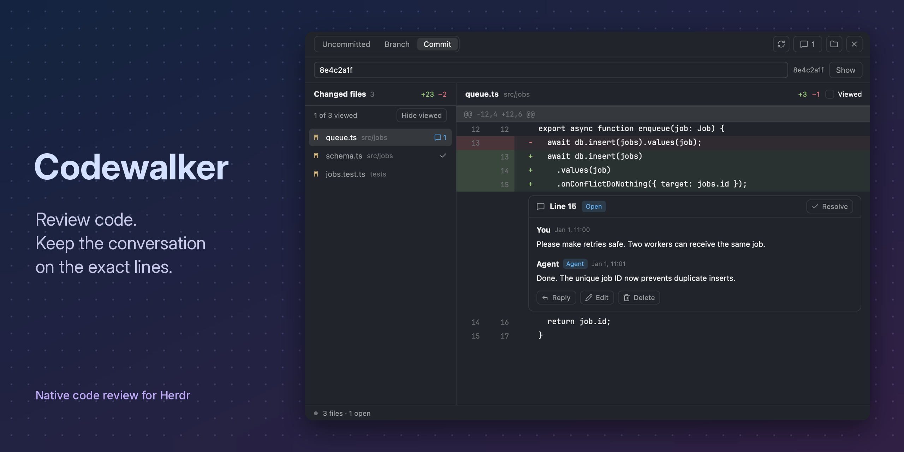

# Codewalker

Native code review for Herdr: uncommitted, branch and single-commit diffs, old/new line discussions, and durable human–agent replies in one local SQLite store. **Review** opens as a pane beside your agent, with a key or a CLI command, or in the side panel of a layout you own. No webview, external review TUI, file browser, staging or committing. Comments reach an agent only when you choose **Send**.



> **No layout included.** This package provides the mod only. Configure your own Herdr layout to choose where it appears and how it opens ([example](#review-in-the-side-panel-your-own-layout)). The preview shows the mod, not a bundled layout.

## Requirements and boundaries

- Installed Herdr desktop with the native mod APIs; verified against `herdr-app 0.1.12` on macOS.
- Python 3.10+ standard library and Git. No npm runtime, database server, network service, API key, or downloaded helper.
- Local checkouts only. A remote space is rejected before local execution; no accidental same-path local fallback.
- Branch review compares the selected local base's **merge-base → working tree**, including committed and uncommitted changes. No automatic fetch.
- Commit review compares **first parent → selected commit**, or empty tree → root commit. Both sides come from Git objects; the index and working tree are excluded. Merge commits use their first parent, not a combined diff.
- Review shows the folder of the pane it opened beside (or `--repo`); never the space's display name. The folder button’s tooltip shows the resolved checkout and branch. Confirm that root before commenting.

## Install

Codewalker follows Herdr's folder-based mod format. **`mods/Codewalker/` is self-contained**: JavaScript, icons, and the Python helper are all included. No build, package manager, or custom installer is required.

1. Download or clone this repository. Read [RECIPE.md](RECIPE.md) and the [data/access notes](#data-and-access) before running trusted mod code.
2. Copy `mods/Codewalker/` to `${HERDR_APP_HOME:-~/.config/herdr-app}/mods/Codewalker/`. Keep `RECIPE.md` and `preview.png` outside the app home. Do not merge into an occupied folder or overwrite a shipped/local mod.
3. Check the installed mod:

   ```sh
   herdr-app check "${HERDR_APP_HOME:-$HOME/.config/herdr-app}/mods/Codewalker"
   ```

Herdr loads the files on save; no restart is needed. Installation adds no layouts, settings, keybindings, or agents. A custom `HERDR_APP_HOME` must be the home of the Herdr instance you intend to update.

### Optional checked installer

For collision detection and later updates, this repository also provides a helper. **This is a project convenience, not a Herdr package manager.**

```sh
python3 scripts/install.py                 # read-only plan
python3 scripts/install.py --apply --check # install/update only owned files
```

It accepts `--home /absolute/app-home` or `HERDR_APP_HOME`, defaults to `~/.config/herdr-app`, and records installed hashes in `codewalker-install.json`. It refuses unknown/local edits and symlinked destinations/ancestors. Settings, keys, other mods, layouts, layout state, and review data stay untouched. Replacement is atomic per file, not a multi-file transaction. Do not delete the receipt to bypass a collision.

A folder installed by copying has no receipt: the helper deliberately refuses to take it over. To update it manually, compare the new version with the installed folder, back up your copy, and replace it only after accounting for local changes. To remove Codewalker, remove its mod folder and any key/layout references you added; its review database is kept separately.

Earlier project installers also installed `mods/codewalker-tabs` and a `codewalker` layout. The helper removes those only when their owned hashes match; switch away from that legacy layout first.

### Prepare a separate package

```sh
python3 scripts/install.py --prepare integration --check
```

This writes a self-contained mod and an ownership receipt under `integration/`, without touching the live app. `--check` executes the mod in Herdr's hidden initial-render checker; it does not test paint, scrolling, focus, or interaction. Use canonical scratch paths on macOS, for example `/private/tmp/codewalker-check`, rather than symlinked `/tmp`.

### Open Review

Add a key to your `keys.json` yourself; the installer doesn't edit it:

```json
"cmd-r": "mod.open:Codewalker"
```

The key opens Review as a pane right of the focused pane, for that pane's folder. Press it again in the same tab to close it. In a terminal, `python3 ~/.config/herdr-app/mods/Codewalker/backend.py open` does the same for that terminal (`--repo` for another checkout). The command palette can't list mod commands, so it has no Review entry.

### Open a specific comparison from another mod

Use Herdr's `pane.split` with an explicit target pane and Codewalker's public props. This opens a new review; it does not toggle or replace an existing review or its draft.

```js
import { run } from "herdr";

run("pane.split", {
  direction: "right",
  pane: targetPaneId,
  mod: "Codewalker",
  props: {
    framed: true,
    folder: "/absolute/local/checkout",
    scope: "commit",
    commit: "abc1234", // full/short SHA, tag, or ref such as HEAD~1
  },
});
```

`scope` defaults to `"uncommitted"`. `"branch"` accepts `base`; `"commit"` requires `commit`. These props also work in a layout block. Use an explicit `folder` to pin the checkout; remote execution remains unsupported. Bare `mod.open Codewalker` remains the existing key toggle and cannot take comparison arguments.

From a local Herdr terminal:

```sh
python3 ~/.config/herdr-app/mods/Codewalker/backend.py open \
  --repo /absolute/local/checkout --scope commit --commit HEAD~1
```

`open` validates and resolves the commit before opening a pane, passes its full SHA, and returns the **new** pane ID, folder, scope and `commitOid`. To get data without opening UI, use `review --scope commit --commit <ref> --json`. See [`docs/protocol.md`](docs/protocol.md).

### Review in the side panel (your own layout)

This example puts a **Review** button beside the tab bar and opens Codewalker in the right-hand panel. It uses the same toolbar-and-panel wiring as our own setup, but does not include a full layout.

Edit only a layout you own, under `${HERDR_APP_HOME:-$HOME/.config/herdr-app}/layouts/`. Never edit Herdr's shipped `main.json`. If you need a personal copy, the following command creates **and switches to** `my-layout`; choose an unused name:

```sh
herdr-app do layout.clone '{"name":"main","as":"my-layout"}'
```

The snippets below are fragments to merge into that copy, not replacement layout files.

1. In `work.children`, replace the standalone `tabs` block with this `tab-bar` row. If you already have a tab-bar row, append only the `review-button` block to its `children`; keep your existing tabs and other buttons:

   ```json
   { "id": "tab-bar", "type": "row", "size": { "px": 42 }, "resizable": false, "children": [
     { "id": "tabs", "type": "block", "size": { "weight": 1 }, "window_drag": true, "content": { "mod": "tabs" } },
     { "id": "review-button", "type": "block", "size": { "px": 88 }, "window_drag": true, "content": { "mod": "Codewalker", "props": { "toolbar": true } } }
   ] }
   ```

2. In the existing `panel` column, append this child to the `panel-body` stack's `children`. Keep Files, Changes, Git, or any other existing children:

   ```json
   { "id": "review", "type": "block", "content": { "mod": "Codewalker" } }
   ```

Keep the IDs **`panel`**, **`panel-body`**, and **`review`** exactly as shown: Codewalker uses them to find, select, and show the panel. Each ID must occur only once. The `panel` column and `panel-body` stack already exist in a copy of `main`; these fragments alone do not create them in an unrelated layout.

Save your personal layout, then click **Review** to show or hide the panel. The button adds `"review"` to the shared `workspace.panels` list, so the shipped tabs mod remembers it per space. The `mod.open:Codewalker` key now toggles this panel instead of a pane. Review follows the focused terminal's local checkout. No pinned folder or personal path is needed.

## Review flow

1. Open Review (see above). It shows the checkout of the pane it opened beside. Drag the pane edge to widen it: below 760 px the changed files sit above the diff, wider they sit side by side. To review another local checkout, choose the folder button beside the scope controls, enter its absolute path and choose **Open**. There is no folder/file browser.
2. Choose **Uncommitted**, **Branch** (enter a local base ref and choose **Compare**), or **Commit** (enter a SHA/ref such as `HEAD~1` and choose **Show**). Returning to a loaded mode shows its last diff immediately and refreshes in the background. Commit mode displays the resolved short SHA and stays pinned to it on refresh and mode switches. **Show** resolves the input again. Scope tooltips explain the comparisons.
3. Select a changed path. Hover a line and press its **+**, or press an **old or new line number**. Drag across line numbers to select a range on one side; a range stays inside the hunk where it started. Shift-click extends an open comment's range.
4. Write a multiline message and choose **Comment** / **Reply** (⌘/Ctrl+Enter). Choose **Edit** on your own message to change it in place (⌘/Ctrl+Enter saves, Esc cancels); it shows as edited and the store keeps the earlier text. **Delete** asks first; deleting your comment removes its whole thread, replies included, while deleting a reply removes only that reply. Check **Ask for a short reply** to have the agent answer in the thread in a few sentences, then go on with its work; the thread shows **Awaiting reply** until someone answers. Messages show Human/Agent attribution. Resolve/Reopen preserves all replies; resolved discussions fold to one line until shown.
5. The 💬 button beside the scope controls (between Refresh and the folder button; the open count is in its tooltip and, when wide, its label) shows **Discussions**: every thread grouped by file, its code, the first comment and replies indented below. Filter by All, Open or Awaiting reply. **Show in diff** opens the file and starts the diff at the thread's hunk with its card marked; **Reply** does that and opens a reply. Esc or the button returns to the files.
6. **Send n** (after the folder button, icon-only in narrow panels, when you have new comments) pastes your new comments into an agent: each open discussion (marked when its code changed since), with its code, messages and thread ID, then the `backend.py skill` command that tells the agent how to reply in the thread. Pick the agent (the focused one, else the only one in this checkout; agents in this space only), add a note, read the exact message, then **Send**. It types only when the agent is idle (`hc send --if idle`, never `--force`), so a permission prompt is never answered for you. Each comment is sent once: it is recorded as unclear before typing and as sent after. If the answer is lost, Review says so; check the agent's chat, then choose **It arrived** or **I checked · Send again**. Focus moves to the agent after a send.
7. CLI/agent replies and code edits appear on their own: Review watches the checkout and the discussion store (15-second fallback), or choose Refresh. Refresh does not replace editor text. **Discussions on unchanged files** lists paths no longer in the diff; stale anchors keep their original context rather than silently moving.

### Viewed files

Check **Viewed** in the diff header when you finish a file. The file list shows a checkmark and **n of m viewed**; **Hide viewed** filters those rows, and **Show all** brings them back. Hiding the current file keeps its diff and draft open. Opening a file never marks it automatically.

Marks survive restarts in the local SQLite store, separately for each checkout/branch, scope and base ref (or full commit SHA in Commit mode). They match that file's old/new content, paths, status and modes—not the whole review snapshot. Changes to that file make it unviewed again; unrelated commits, files and discussions do not. Returning to the exact marked version restores its mark. Files without reliable content fingerprints (such as oversized worktree files or symlinks) cannot be marked. This is a local checklist, not a GitHub viewed-state sync.

Drafts autosave after 300 ms and before navigation/posting. A save conflict keeps your text and shows an error; refresh and reconcile before retrying. Esc or the composer's close button removes the composer and keeps its saved text; **Discard** deletes the draft. Saved drafts can be restored from the navigator.

Posts use durable idempotency receipts. If a helper response is lost, **Retry saved post** replays the original command, not a new message. The exact envelope is saved with the draft before dispatch, so restoring after a mod/app restart can recover the same attempt. A known accepted post is not retried because draft cleanup failed; cleanup is reported separately. This is deduplicated local mutation, not a claim of exactly-once external delivery.

Long text diffs are paged at 240 rendered rows to keep actual inline editors/buttons within native event-lifetime rules. Binary, oversized and unsupported changes display metadata instead of fake line anchors. This first version is unified diff only; split view, syntax-highlight infrastructure, file editing, forge sync, and remote execution are out of scope.

## Agents use the same store and CLI

See [`docs/agent-workflow.md`](docs/agent-workflow.md) for copyable agent commands and [`docs/protocol.md`](docs/protocol.md) for the exact JSON contract, optimistic revision checks, actor attribution, limits, and recovery rules. Native behavior and the pending manual checklist are in [`docs/ux.md`](docs/ux.md).

```sh
python3 /absolute/herdr-codewalker/mods/Codewalker/backend.py \
  --repo /absolute/checkout review --scope uncommitted --json

python3 /absolute/herdr-codewalker/mods/Codewalker/backend.py \
  --repo /absolute/checkout list --json
```

The installed copy exposes the identical CLI at `~/.config/herdr-app/mods/Codewalker/backend.py`. Mutations require `reviewId`, `expectedRevision`, a stable `commandId`, and actor metadata. Agents must call this API rather than edit SQLite or scrape a terminal. No agent is launched or authorized by the mod, and it contacts one only when you choose **Send**.

## Data and access

The helper reads local Git metadata and bounded changed-file content. It writes only local review/draft state; source and index remain read-only. On macOS the default store is `~/Library/Application Support/herdr-codewalker/reviews.sqlite3`; other platforms use user-data paths documented in the protocol. Snippets and messages are not encrypted or synchronized. Back up the database using normal SQLite-safe procedures.

Herdr mods are trusted code with the user's process permissions. This package runs `python3` and Git locally; it does not call a model, reach the network, or update itself. **Send** pastes text into the agent terminal you choose, through `hc send --if idle`.

## Verification

```sh
python3 -m unittest discover -s tests -p 'test_*.py'
node --experimental-vm-modules --test tests/test_ui.mjs
python3 scripts/check-ui.py  # synthetic populated inline/retained/composer states
python3 scripts/install.py --prepare integration --check
```

The UI tests exercise async draft/navigation/post state; independent acceptance tests exercise actual CLI/SQLite/Git and lost-response/restart deduplication. Native initial/eager render checks pass for the review mod. Do not treat a hidden `check` as visual or interaction verification.

## Distribution assets

[RECIPE.md](RECIPE.md) describes the shipped behavior and rebuild requirements. [Preview documentation](docs/preview.md) records the synthetic native screenshot, composition, and reproduction commands. The preview uses demo data, not a private checkout or agent transcript.

Publication requires a public GitHub repository containing this package and the `herdr-mod` topic. Herdr's guide says eligible packages appear in the [community gallery](https://herdr.dev/mods/) within the hour; indexing is not guaranteed. Verify the live catalog after publication.

## License

Codewalker is [MIT licensed](LICENSE), copyright © 2026 Reda Lemeden. The self-contained mod folder includes a copy of the license.

Third-party assets retain their own terms: [Lucide/Feather icons](mods/Codewalker/icons/LICENSE) use ISC/MIT; the Inter font used only for preview artwork uses [SIL OFL 1.1](docs/preview-assets/INTER-LICENSE.txt).
