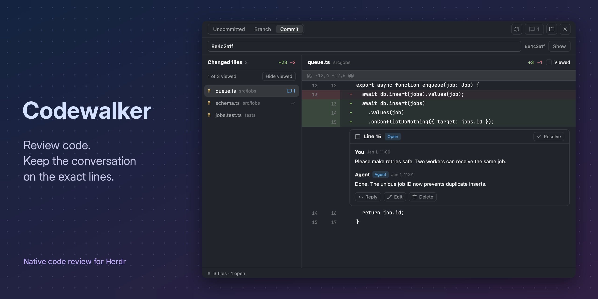

# Codewalker

Review a local checkout without leaving Herdr. Read uncommitted, branch, or single-commit diffs; mark files as viewed; and keep questions and agent replies attached to the exact lines. Comments reach an agent only when the reviewer chooses **Send**.



## What you see

The mod uses Herdr's theme and installed UI/code fonts. It is a full-height native view, not a webview or terminal application.

- **Toolbar:** Uncommitted, Branch, and Commit segments, then Refresh, Discussions, and Change folder icons. Send appears when there are unsent or uncertain comments. An overlay also offers Close. There is no separate title row. Standard controls are 26px high, small ones 22px; text is mostly 12–13px, with 11px metadata.
- **Comparison input:** Branch adds a local base-ref field and Compare. Commit adds a SHA/ref field, Show, and the resolved short SHA. Comparison details are in tooltips. Folder entry appears on request or when no checkout is connected.
- **Changed files:** paths, change status, optional line counts, discussion count, viewed checkmarks, and an explicit **n of m viewed** row with Hide viewed / Show all. Retained discussions and saved drafts remain accessible below changed files.
- **Diff:** file header with Viewed, Git old/new line numbers, added/deleted line backgrounds, and inline discussion cards. Hover reveals a comment button. Binary, oversized, and special-file changes have an explanation rather than fake lines. Empty-state padding is 14px horizontally and 12px vertically.
- **Discussion cards:** original location, open/resolved state, authors, timestamps, Markdown messages, Reply, and author-only Edit/Delete. A new comment can request a short reply; unresolved requests show Awaiting reply. Resolve is in the card header. Stale discussions keep their original code evidence.
- **Composer:** a multiline editor that grows from three to seven rows, local draft status, Ask for a short reply, Discard, and Comment/Reply. It can appear inline or below the visible lines when its anchor is outside the page.
- **Discussions view:** all threads grouped by file, with All/Open/Awaiting filters and Show in diff. **Send view:** agent picker, optional note, exact message preview, and explicit Send.
- **Footer:** a small idle/working/error dot and file, open-discussion, and saved-draft counts.

At 760px or wider, files and diff sit side by side; the list is 240px wide, or 280px at widths of at least 1000px. Narrower panels stack the list above the diff and cap it at about a third of the height. Below 560px, line gutters and toolbar spacing shrink. The main horizontal content row stretches its columns so their scroll regions fill the available height.

The gallery preview uses a real native render with documented synthetic data. It shows commit review, a viewed checklist, and a human–agent discussion; its title and subtitle are outside the runtime UI.

## How it behaves

- **Uncommitted:** HEAD → working tree, including staged, unstaged, and nonignored untracked changes. **Branch:** merge-base(selected base, HEAD) → working tree. **Commit:** first parent → selected commit, or empty tree → root commit. A merge uses its first parent. Commit mode never reads working-tree content for the diff and never checks out the commit.
- A commit ref resolves to a full SHA and stays pinned through refresh and mode navigation. Show resolves the input again. Invalid refs or unavailable shallow parents report errors; they do not fall back to a worktree review or fetch history.
- Each mode keeps its last comparison for the current checkout. Returning to the same base/ref restores its selected diff and page immediately, then refreshes in the background. Cached discussions and viewed state are read-only until revalidated. Failed refreshes retain the old diff with an explanation. Another checkout clears these caches.
- Selecting a file reuses its current-snapshot diff when available. Otherwise the previous diff remains dimmed and its gutters are inert until the requested file arrives. Newer navigation wins over late helper responses.
- Click an old/new line number or hover comment button to comment. Drag across line numbers for a range inside one hunk; Shift-click extends a range. Post uses the snapshot of the displayed rows, and stale evidence is rejected rather than silently retargeted.
- Drafts autosave after 300ms and before navigation/posting. A failed save keeps the current text and review. Escape or Close keeps a draft; Discard deletes it. Cmd/Ctrl+Enter submits. Escape also cancels a drag, delete confirmation, or message edit before leaving the discussions/send view.
- Viewed is explicit, never inferred from opening or scrolling. Marks survive restarts and match each file's content, paths, status, and modes. Unrelated edits preserve them; changes to that file make it unviewed. Hide viewed does not close the selected diff or discard its draft.
- Checkout/store folder watches trigger a debounced refresh; a 15-second timer covers missed events. Git object/log noise and recent local draft writes are ignored. Refresh does not overwrite editor text.
- Send targets only the selected ready agent. Working or blocked agents cannot receive it. Delivery is recorded as uncertain before `hc send --if idle`, then sent after confirmation. A refusal clears the record; an unclear outcome stays uncertain until the reviewer checks the agent's chat. Ordinary sends do not duplicate previously sent comments.
- Without a pinned folder/space, Review follows the focused terminal's checkout, or the active space's folder. It saves a draft before following. Remote checkouts are rejected before any local helper execution.

## Built from

`mods/Codewalker/` is the complete runtime folder:

- `main.js`: GPUI `View`, native gpui-base layout, buttons, checkboxes, inputs, text areas, and Markdown text; navigation, draft lifecycle, file watches, bounded caches, and agent delivery.
- `client.js`: argv-only `exec("python3", ...)` calls to the adjacent `backend.py`, read normalization, serialized mutations, revision tracking, and persisted post receipts.
- `model.js`: diff/anchor, discussion, formatting, and delivery-text helpers.
- `backend.py`: Python 3.10+ standard library, read-only Git subprocesses, and transactional SQLite review storage. It also provides the documented JSON CLI and agent instructions via `skill`.
- `mod.json`: focusable mod, `place: none`, and a tiny `launch: true` popup used only to toggle the review pane/panel. Direct pane copies use `framed: true`. `review.svg` and `icons/` provide the artwork; Lucide attribution is in `icons/LICENSE`.

Herdr APIs include `props`, `spaces`, `panes`, `focused`, `agents`, `exec`, `hc`, `appHome`, `theme`, `settings`, `watchFolder`, `nextCommand`, `layout`, `shared`, `setShared`, `run`, `notify`, and `closeOverlay`. Commands include pane split/close/focus and layout show/hide/select. A `toolbar: true` copy draws a Review button for a compatible personal panel stack; no layout is shipped or installed.

Other mods open a review with:

```js
run("pane.split", {
  direction: "right", pane: targetPaneId, mod: "Codewalker",
  props: { framed: true, folder: absoluteLocalCheckout, scope: "commit", commit: fullSha },
});
```

Branch mode accepts `base`; uncommitted is the default. Use an explicit local checkout and live target pane. This creates a separate review and keeps existing panes/drafts. Bare `mod.open Codewalker` is a toggle, not the comparison API.

## Watch out

- Mods are trusted code. Codewalker runs Python, Git, `hc`, and `herdr-app`; reads checkout content and agent/pane metadata; and writes local comments, snippets, drafts, viewed marks, and delivery receipts. It makes no direct model/network calls. Send passes review text to the chosen agent; that agent may use a remote provider.
- The store is separate from the mod: on macOS, `~/Library/Application Support/herdr-codewalker/reviews.sqlite3`. Content is not encrypted or synchronized. Back up with SQLite-safe procedures. Never write the database directly from an agent or remove it during installation.
- Git reads disable optional locks, hooks, external diff/textconv, and configured clean/filter drivers. No stage, checkout, commit, or fetch operation is provided. Paths are literal and checked; symlinks are not followed to read arbitrary external content.
- Text previews have per-file, total-byte, changed-path, and output limits. Over-limit or unsupported files keep metadata and old discussion evidence. Do not make up line anchors. The protocol documents the precise bounds and platform argument-size limitations.
- Review identity remains scoped to the canonical worktree and checked-out branch. Selecting a historical commit does not change that identity. Historical comments identify their commit so agents can inspect current code before acting.
- Save exact mutation IDs/envelopes before uncertain writes. Repeating a command must not duplicate a discussion or delivery. Checkout, revision, and snapshot conflicts are distinct failures.
- Copy the whole runtime folder, including `backend.py`. `backend/codewalker.py` at the repository root is only a legacy source-checkout compatibility entry point. Do not copy only the JavaScript or require the source repository at runtime.
- Names are case-insensitive on common macOS filesystems. Do not overwrite an existing `Codewalker`/`codewalker`. A deliberate rename also requires updating mod names, self-opening calls, icon/helper paths, and external Git-mod integration; the optional installer does not perform that adaptation.
- The key popup is not a review window. Use pane props or explicit non-launch overlay dimensions. Never copy a shipped tab-bar/layout to add Review; integrate into a personal layout instead.
- Hidden `herdr-app check` verifies initial native descriptions/materialization, not painting, scrolling, pointer behavior, or later asynchronous states. Screenshot fixtures must not read a real checkout, write its store, or send to real agents.

## Done when

1. Copy only `mods/Codewalker/` into a new app home. `herdr-app check` succeeds and its Python helper can review a temporary Git repository without the source checkout or an installer.
2. Verify uncommitted, branch, ordinary/root/merge/empty commit comparisons; invalid refs and unavailable parents must fail clearly. Git index and source content stay unchanged.
3. Save/reopen a draft, post/reply/edit/delete a discussion, mark/unmark a file, and change modes without losing text or briefly showing the wrong comparison. A cached-mode revalidation failure must not send stale comments.
4. Exercise revision/snapshot conflicts, concurrent writers, and lost-response retries. Inspect actual Git/SQLite results, not only mocks.
5. Run the repository's Python and JS tests, native UI checks, and isolated package check listed in README. Install with collision protection and inspect app status.
6. Inspect the native demo and 2560×1280 `preview.png`: readable marketing title/subtitle left, real diff/discussion UI right, no private user data. Keep the sanitized source crop and reproduction script.
7. Before publishing, retain the MIT license and third-party notices, review the package, push it to its public repository, add `herdr-mod`, and verify the catalog entry rather than assuming discovery succeeded.
